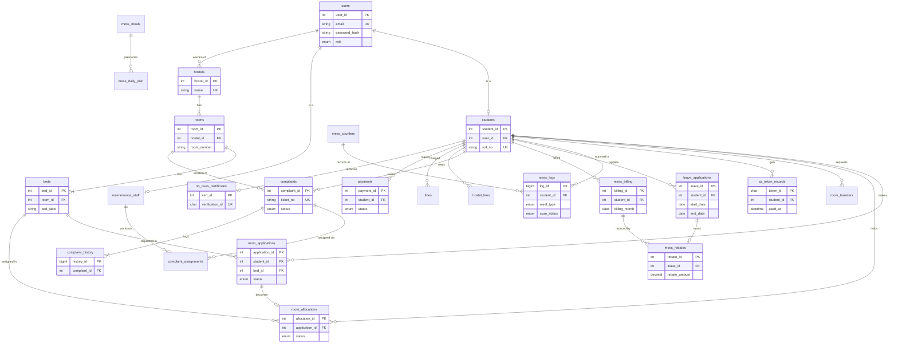

# Smart Campus: Database Design

## ER diagram (paste into https://mermaid.live to view or export as an image)

## Relationships and cardinality

| Relationship | Type | Notes |
|---|---|---|
| users - students / maintenance_staff | 1 : 0..1 | UNIQUE on the FK; every student *is* a user |
| hostels - rooms - beds | 1 : N, 1 : N | A room cannot exist without a hostel (total participation) |
| students - room_applications | 1 : N | Only ONE can be live (reserved/pending) at a time |
| room_applications - room_allocations | 1 : 0..1 | Approved application becomes one allocation |
| beds - room_allocations | 1 : N over time | Only ONE can be `active` |
| students - leave_applications | 1 : N | Overlaps blocked by trigger |
| leave_applications - mess_rebates | 1 : 0..1 | UNIQUE(leave_id): at most one rebate per leave |
| complaints - complaint_assignments | 1 : N | History of assignees; only one `is_current` |
| complaints - complaint_history | 1 : N (min 1) | Written by triggers |
| students - ledger sources | 1 : N each | Summed separately in the `student_ledger` view |

## Normalization (3NF) in plain words

A table is in 3NF when every non-key column depends on *the key, the whole key, and nothing but the key*.

- **Hostel name is not stored in beds.** `bed_id -> room_id -> hostel_id -> name`. If `hostel_name` sat in `beds`, renaming a hostel would mean updating hundreds of rows (a transitive dependency). Separate tables remove it.
- **`users` holds name/email once.** `students` keeps only student-specific facts (`roll_no -> department, year`). One person, one place.
- **Dependencies:** `user_id -> email, role`; `student_id -> roll_no, department`; `(student_id, billing_month) -> gross_amount` (UNIQUE key); `leave_id -> student_id, dates`; `complaint_id -> category, status`.
- **Deliberate, controlled redundancy:** `mess_billing.rebate_total` and `net_amount` are derived. We keep them for fast display, but only `sp_sync_billing_rebate` writes them, and the ledger view uses `mess_rebates` as the source of truth, so totals can never disagree. `mess_logs.meal_date` duplicates the date of `scan_timestamp` so a UNIQUE index can use it.

## How rules are enforced in the database (not just in Python)

| Rule | Mechanism |
|---|---|
| One bed, one live booking | generated column `live_bed_key` + UNIQUE |
| One student, one live booking | generated column `live_student_key` + UNIQUE |
| One active allocation per bed / student | `active_bed_key`, `active_student_key` + UNIQUE |
| No second meal in a day | `success_student_id` + `meal_date` + `meal_type` UNIQUE |
| One rebate per leave | UNIQUE(`leave_id`) and `ON DUPLICATE KEY UPDATE` |
| Rebate math and billing sync | trigger -> `sp_apply_rebate` / `sp_reverse_rebate` |
| Complaint history | AFTER INSERT / UPDATE triggers |
| No-Dues only when balance is cleared | `sp_generate_no_dues` + CHECK on the certificate |

Referential integrity means a child row cannot point to a parent that does not exist (for example an allocation to a deleted bed), because InnoDB foreign keys refuse it.

## Things to remember

- Two rules need transactions in the app, not only constraints: the **2-hour anti-passback** (time-based) and **expired reservations**. A reservation past its expiry stops showing as taken in `v_bed_status`, but its UNIQUE key still holds the bed until `sp_expire_stale_reservations()` runs. The booking code must call it first.
- Hostel gender (boys/girls) vs student gender is checked in the booking service.
